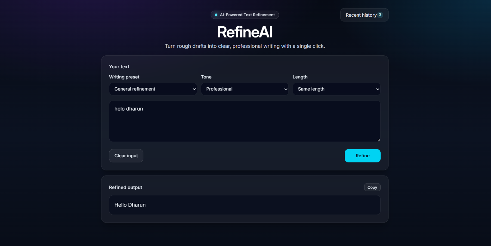

# RefineAI

RefineAI is an AI-powered writing assistant that transforms messy, informal text into clear, professional communication.


### What It Does

- Improves grammar and clarity  
- Enhances tone and professionalism  
- Keeps the original meaning intact  
- Delivers a single, refined output  
- Supports professional or friendly tone and same-length or shortened output
- Includes general refinement, professional message, and academic writing presets
- Saves up to 20 successful refinements in this browser, with individual and clear-all deletion
- Lets users clear the input, copy refined text, and review recent history in a side panel

### Screenshot



### Run Locally

Requirements: Java 17 or later, Node.js, and a Groq API key.

Create a local backend environment file (it is ignored by Git) and add your Groq API key:

```powershell
cd backend
Copy-Item .env.example .env
# Edit .env and replace the placeholder with your actual Groq API key.
.\mvnw.cmd spring-boot:run
```

The backend also accepts `GROQ_API_KEY` from its process environment. A process environment variable takes precedence over `backend/.env`, so update or clear any old value in the terminal or IDE used to launch the backend. A rejected/expired key must be replaced with a valid key from Groq; restart the backend after changing it.

Keep the backend terminal open. In a separate terminal, start the frontend:

```powershell
cd frontend
npm install
npm run dev
```

Open the local URL printed by Vite (by default, `http://localhost:5173`). The frontend uses `http://localhost:8080` for the backend by default. Set `VITE_API_URL` in the frontend environment if the backend uses a different base URL. Never commit `backend/.env` or share API keys.

### Refinement API

The frontend sends refinement requests to `POST /api/groq/response` as JSON:

```json
{
  "prompt": "The text to refine",
  "preset": "GENERAL",
  "tone": "PROFESSIONAL",
  "length": "SAME_LENGTH"
}
```

The API key is configured on the backend using `GROQ_API_KEY` in its process environment or `backend/.env`. If Groq rejects the key, the API returns `502 Bad Gateway` with an actionable error; replace it with a valid key and restart the backend.
